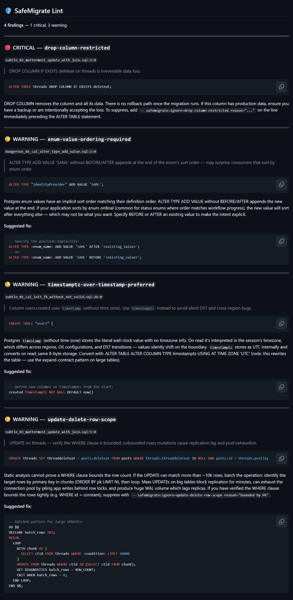

# safemigrate-lint

[](https://github.com/Harshith029/safemigrate-lint/actions/workflows/ci.yml)
[](https://pypi.org/project/safemigrate-lint/)
[](https://opensource.org/licenses/MIT)

A GitHub Action that lints Postgres migration SQL on every PR, and tells you which lock each flagged operation takes and what that blocks. Static analysis only — no database connection, no schema access.

- 32 safety rules + 7 opt-in style rules. **CRITICAL is reserved for hazards the diff doesn't reveal** — a rewrite hiding inside `ALTER COLUMN TYPE`, not a `DROP COLUMN` you can see and meant to write
- Real Postgres parser via [pglast](https://github.com/lelit/pglast) (libpg_query) — the PG 17 grammar, so extension SQL (TimescaleDB, PostGIS) parses like anything else
- Cross-statement context — suppresses FK-to-new-table and similar false positives that pile up in single-statement linters, using ordered, schema-qualified state so a later statement can't excuse an earlier hazard
- Lock impact on each finding — which lock the operation takes, how long it's held, and what it blocks
- Posts a find-or-create PR comment with per-finding detail; creates a Check Run with severity-mapped conclusion

## Demo

On every pull request, safemigrate-lint posts a comment that groups findings by severity — each with the lock it takes and the safe rewrite — and sets a Check Run conclusion you can require in branch protection.



<details>
<summary><b>Example PR comment</b> (click to expand)</summary>

```text
## 🛡️ SafeMigrate Lint

**2 findings** — 1 critical, 1 warning.

🔒 Heaviest lock: ACCESS EXCLUSIVE — blocks reads + writes.

### 🔴 CRITICAL — column-type-change-rewrites-table
migrations/0042_cleanup.sql:2
ALTER COLUMN amount TYPE on payments rewrites every row and locks the table.

🔒 Lock: ACCESS EXCLUSIVE | held: full table rewrite | blocks: reads + writes
safe path: expand-contract (new column, backfill, swap)

### 🟡 WARNING — constraint-not-valid-required
migrations/0042_cleanup.sql:8
ADD CONSTRAINT orders_user_fk FOREIGN KEY without NOT VALID requires a full
table scan.

🔒 Lock: SHARE ROW EXCLUSIVE | held: table scan to validate | blocks: writes on
both the referencing and referenced table (reads still OK)
safe path: ADD ... NOT VALID (instant), then VALIDATE CONSTRAINT
(ShareUpdateExclusive — non-blocking)

Suggested fix:
  ALTER TABLE orders ADD CONSTRAINT orders_user_fk FOREIGN KEY (...) NOT VALID;
  -- then, in a separate migration:
  ALTER TABLE orders VALIDATE CONSTRAINT orders_user_fk;
```

</details>

## Why

Most teams don't lint migrations at all — the check that catches an
`ALTER TABLE` about to hold AccessExclusiveLock for four minutes simply isn't in
their pipeline. That's the gap this fills, and it's why the install path is one
paste rather than a binary plus a workflow you write yourself.

On rule selection, honestly: the catalog was assembled largely by working
through what [squawk](https://github.com/sbdchd/squawk), Atlas, and Bytebase
already check, then reading migration history from Cal.com, Mattermost,
Supabase, Hasura, and TimescaleDB to decide which of those belong in a
**default-on** gate and which are opinions. The commit log names the source rule
for most of them. What's distinctive here isn't the rule list — it's that each
finding reports the lock the operation takes and what that blocks, and that
suppression is ordered and schema-aware rather than whole-file.

Atlas lists migration linting and safety checks under its Pro plan: $9 per developer per month, plus $59 per month for each CI/CD project (two target databases included, $39 per month for each additional one), per [atlasgo.io/pricing](https://atlasgo.io/pricing) as of November 2026. This action is free, MIT.

Two limits worth stating up front, because they bound how much this can tell
you. There is no database connection, so nothing here knows your table sizes,
your `search_path`, or whether your migration runner wraps files in a
transaction. And a *missing* finding is not evidence a migration is safe — it
means no rule matched.

## Quickstart

Drop this into `.github/workflows/lint-migrations.yml`:

```yaml
name: Lint migrations
on:
  pull_request:
    paths:
      - 'migrations/**/*.sql'

permissions:
  contents: read
  pull-requests: write
  checks: write

jobs:
  lint:
    runs-on: ubuntu-latest
    steps:
      - uses: actions/checkout@v4
      - uses: Harshith029/safemigrate-lint@v1
        continue-on-error: true
        with:
          paths: 'migrations/**/*.sql'
        env:
          GITHUB_TOKEN: ${{ secrets.GITHUB_TOKEN }}
```

For maximum reproducibility, pin to a commit SHA (`@<full-sha>`) instead of `@v1`.

### Why `continue-on-error: true`?

The action's step exits non-zero whenever the lint finds anything (so workflows that don't set this turn red on every PR with findings). Use the **Check Run** as the semantic signal instead — it maps severity to conclusion:

| findings              | check conclusion  | meaning                                  |
| --------------------- | ----------------- | ---------------------------------------- |
| none                  | `success`         | safe to merge                            |
| warnings / style only | `neutral`         | review, but doesn't block                |
| any critical          | `action_required` | a cost the SQL doesn't look like it has  |

In branch protection, require `safemigrate-lint` (the Check Run name) as a status check. The PR will be blocked on critical findings while warnings stay non-blocking.

### Pull requests from forks

GitHub runs workflows for pull requests from forks with a read-only
`GITHUB_TOKEN`, whatever the workflow's `permissions:` say. The action still
lints, and the result is in the job log and the job summary, but it can't post
the PR comment or create the `safemigrate-lint` Check Run — so a branch
protection rule that requires that Check Run leaves a fork's PR waiting on a
check that never arrives. The step logs a warning saying exactly that.

To gate fork PRs as well, make the job itself the check: drop
`continue-on-error`, set `fail-on`, and require the job (here, `lint`) in branch
protection instead of the Check Run.

```yaml
      - uses: Harshith029/safemigrate-lint@v1
        with:
          paths: 'migrations/**/*.sql'
          fail-on: critical          # the job fails on critical findings only
        env:
          GITHUB_TOKEN: ${{ secrets.GITHUB_TOKEN }}
```

Don't switch the workflow to `pull_request_target` to get a write token: that
would run a contributor's SQL through a native parser with write access to your
repository.

### Linting only the migrations a PR changed

By default the action lints **every** file matching `paths`. On a repo with a lot
of existing migrations, that re-reports findings on old, already-shipped ones on
every PR. To judge a PR only on the migrations it actually introduces, compute
the diff and pass it to `paths` — pure `git`, no third-party action:

```yaml
jobs:
  lint:
    runs-on: ubuntu-latest
    steps:
      - uses: actions/checkout@v4
        with:
          fetch-depth: 0                          # so the diff can see the base branch
      - id: changed
        run: |
          base="${{ github.base_ref }}"
          files=$(git diff --name-only --diff-filter=ACMR "origin/$base...HEAD" \
                  | grep -E '^migrations/.*\.sql$' | tr '\n' ' ' || true)
          echo "files=$files" >> "$GITHUB_OUTPUT"
      - if: steps.changed.outputs.files != ''
        uses: Harshith029/safemigrate-lint@v1
        continue-on-error: true
        with:
          paths: ${{ steps.changed.outputs.files }}
        env:
          GITHUB_TOKEN: ${{ secrets.GITHUB_TOKEN }}
```

This is the recommended setup for **existing** projects: new PRs are judged only
on the migrations they add, not your whole history.

## Other ways to run it

The same engine ships three ways — use whichever fits your workflow.

### CLI

```bash
# from PyPI
pipx install safemigrate-lint           # or: uv tool install safemigrate-lint
# …or straight from source
pipx install git+https://github.com/Harshith029/safemigrate-lint

safemigrate-lint migrations/*.sql       # exit 0 clean · 1 findings · 2 input error
safemigrate-lint migrations/*.sql --severity=critical,warning,style --format=markdown
```

### pre-commit

Catch dangerous migrations before they're even committed:

```yaml
# .pre-commit-config.yaml
repos:
  - repo: https://github.com/Harshith029/safemigrate-lint
    rev: v1.3.0
    hooks:
      - id: safemigrate-lint
```

Runs on staged `*.sql` files and blocks the commit on any finding.

## Reference

### Inputs

| name       | default              | description                                                          |
| ---------- | -------------------- | -------------------------------------------------------------------- |
| `paths`    | (required)           | Globs or files, one per line (a name containing spaces needs its own line); a single line may also list several, space-separated |
| `severity` | `critical,warning`   | Comma-separated severity levels to include: `critical,warning,style` |
| `format`   | `json`               | Output format for the action log: `json` or `markdown`               |
| `fail-on`  | `any`                | Which findings fail the step: `any`, `critical`, or `never`. Input errors always fail it |

### Outputs

| name             | type                | description                                       |
| ---------------- | ------------------- | ------------------------------------------------- |
| `findings-count` | integer             | Total findings emitted after severity filter      |
| `has-critical`   | `"true"` / `"false"`| Whether any critical-severity finding was emitted |

The report also goes to the job summary. Each finding's `line` and `column` are
1-based and point at the first keyword of the statement it concerns.

### Required permissions

| scope                   | needed for                                |
| ----------------------- | ----------------------------------------- |
| `contents: read`        | checking out migration files              |
| `pull-requests: write`  | posting / editing the PR comment          |
| `checks: write`         | creating the Check Run                    |

Pull requests from forks never get the two write permissions — see
[Pull requests from forks](#pull-requests-from-forks).

### Lock impact

Findings whose concern is a lock carry a `lock_impact` object — the lock mode the
operation acquires, how long it's held, and what it blocks. This is derived
statically from the Postgres documentation; **no database connection is involved**.

```json
{
  "rule_id": "constraint-not-valid-required",
  "severity": "warning",
  "lock_impact": {
    "lock": "SHARE ROW EXCLUSIVE",
    "held": "table scan to validate",
    "blocks": "writes on both the referencing and referenced table (reads still OK)",
    "note": "safe path: ADD ... NOT VALID (instant), then VALIDATE CONSTRAINT (ShareUpdateExclusive — non-blocking)"
  }
}
```

The lock can depend on the statement, not just the rule. This same rule reports
`ACCESS EXCLUSIVE` for `ADD CONSTRAINT ... CHECK`, because Postgres takes
SHARE ROW EXCLUSIVE for a foreign key (on both tables) and ACCESS EXCLUSIVE for
a check constraint.

The markdown report adds a per-finding lock line plus a "Heaviest lock" summary at
the top, so a reviewer can see the worst lock in the migration without reading
every finding.

25 of the 39 rules carry a lock impact. The other 14 are omitted deliberately
rather than left as a gap:

| omitted                                                        | why                                          |
| -------------------------------------------------------------- | -------------------------------------------- |
| style + type-choice rules                                        | opinions about types and syntax, not locks   |
| correctness rules (duplicate index columns, enum value ordering) | the concern is a broken result, not blocking |
| `analyzer-blind-on-dynamic-sql`                                  | unknowable by definition                     |
| `DROP DATABASE`, transaction nesting / uncommitted transaction   | no table lock to report                      |
| `index-concurrent-in-transaction-banned`                         | Postgres rejects it *before* it acquires anything |

The `note` field is used honestly. Several operations take a heavy lock only
briefly — `DROP COLUMN` is ACCESS EXCLUSIVE but catalog-only and instant — so the
note says the real risk is data loss or application breakage rather than implying
an outage the operation won't cause.

### Supported Postgres versions

The grammar comes from libpg_query (via pglast), so it's Postgres's own parser
rather than a reimplementation. But it's one **specific** version's parser:

| | |
| --- | --- |
| Grammar version | **Postgres 17** |
| Parses cleanly | anything valid in PG 17 and earlier, including extension SQL (TimescaleDB, PostGIS) |
| Known gap | PG 18 syntax. `GENERATED ALWAYS AS (...) VIRTUAL` is reported as a syntax error |

If you write PG 18-only syntax, the affected file reports a `syntax-error`
finding rather than being silently skipped. The version is pinned by a test, so
upgrading it is a deliberate change rather than a side effect of a dependency
bump — and the package depends on `pglast>=7.20,<8`, so a PyPI install, the
pre-commit hook and the Action image all parse the same PostgreSQL 17 grammar.
(Earlier releases allowed any newer pglast, and a fresh install could pick up a
PostgreSQL 18 grammar instead.)

### Cross-statement context: what it assumes

Suppression — "this ALTER is cheap because the table was created earlier in this
file and is still empty" — only applies when the file itself establishes both
halves. Where it can't, the finding is reported.

- **Which relation a name means.** Names are compared schema-qualified. An
  unqualified name follows `SET search_path` / `set_config('search_path', ...)`
  in the file; under the default path it means `public`. When the path is empty
  or computed at run time, unqualified names match nothing. Indexes are matched
  in their table's schema; `DROP`, `RENAME` and `SET SCHEMA` are followed.
- **Whether it's still empty.** `INSERT`, `COPY ... FROM` and `MERGE` (including
  inside a `WITH` clause), `CREATE TABLE AS`, `REFRESH MATERIALIZED VIEW`, and
  attaching a populated partition or inheritance child all count as writes. A
  `DO` block that can write, `CALL`, and `EXECUTE` are opaque, so they count as
  writing to everything created before them.
- **Not visible at all:** rows written by a function called from a `SELECT`, by
  a trigger or by a rule; and `CREATE TABLE IF NOT EXISTS` is taken at its word.
- **Transactions are the ones written in the file.** `BEGIN`/`COMMIT` are
  tracked; a transaction your migration runner wraps around each file is not.
  If your runner does that, `CREATE INDEX CONCURRENTLY` and the other
  `CONCURRENTLY` forms fail inside it — give each one its own migration with the
  runner's no-transaction option.

### Inline suppression

For a one-off justified exception, prefix the statement with an ignore comment:

```sql
-- safemigrate:ignore=drop-column-restricted reason="column archived to data warehouse before drop"
ALTER TABLE users DROP COLUMN legacy_referrer;
```

### Configuration via `.safemigrate.toml`

Optional repo-level config. Walks upward from the first linted file to find it.

```toml
[rules]
disabled = ["timestamptz-over-timestamp-preferred"]    # hard-disable, never fires

[rules.style]
enabled = ["bigint-over-int-preferred"]                # promote STYLE -> WARNING in default mode
```

## How it compares to squawk

[squawk](https://github.com/sbdchd/squawk) is the closest other free OSS option. Both lint Postgres migrations, both are MIT.

|                                          | safemigrate-lint                                | squawk                          |
| ---------------------------------------- | ----------------------------------------------- | ------------------------------- |
| Parser                                   | pglast (libpg_query — Postgres's own parser, PG 17 grammar) | Rust reimplementation           |
| Parse failures, 2,497 real migrations    | 20 (all MySQL files or psql scripts)            | those same 20, plus 3           |
| Cross-statement context                  | yes — ordered, schema-qualified; suppresses FK / index / constraint rules only on tables created earlier and still empty | per-statement only |
| Out-of-the-box GitHub Action             | yes (this repo)                                 | shipped binary + DIY workflow   |
| PR comments + Check Run                  | built-in                                        | DIY                             |
| Rule count                               | 32 safety + 7 opt-in style                      | 37 rules                        |
| Findings on default settings, 27-fixture corpus | 31                                          | 234                             |

> Both counts measured on this repo's `fixtures/migrations/` — squawk 2.56.0 and safemigrate-lint 1.3.0, each in its default configuration. Reproduce with `squawk fixtures/migrations/*.sql` and `safemigrate-lint fixtures/migrations/*.sql`.
>
> **This measures volume, not accuracy.** Neither number says anything about how many real problems each tool caught — establishing that needs migrations with known outcomes, which nobody has published. A tool that reported nothing would "win" this row. What the gap does show is a difference in default posture: most of squawk's extra findings are style rules (`prefer-robust-stmts`, `prefer-bigint-over-int`, `prefer-identity`, …) that this tool ships as opt-in. If you want those on by default, that's an argument for squawk, not against it.
>
> On parsing, measured rather than asserted, over 2,497 real migrations from cal.com, Mattermost, Supabase and Windmill: squawk reported a syntax error on 23 files, this tool on 20, and those 20 are a strict subset — all of them MySQL migrations or psql scripts that neither tool should accept. The 3 extra are Windmill views written as `CREATE OR REPLACE VIEW v AS (SELECT ...)`; squawk's parser rejects the parenthesized body, libpg_query accepts it.
>
> That is the entire measured difference: 3 files in 2,497, on one construct. An earlier version of this README claimed an advantage on *extension* SQL — squawk parses PostGIS and TimescaleDB DDL perfectly well, and that claim was false.

If you want the broadest rule catalog and you're comfortable wiring the action yourself, squawk is mature and well-maintained. If you want a one-paste install plus FK-to-new-table suppression by default, this is the trade.

## Contributing

Contributions welcome — especially new rules and false-positive reports. See
[CONTRIBUTING.md](CONTRIBUTING.md) for the dev setup and rule philosophy, and
[docs/writing-a-rule.md](docs/writing-a-rule.md) for a step-by-step rule walkthrough.

## License

MIT — see [LICENSE](LICENSE).
